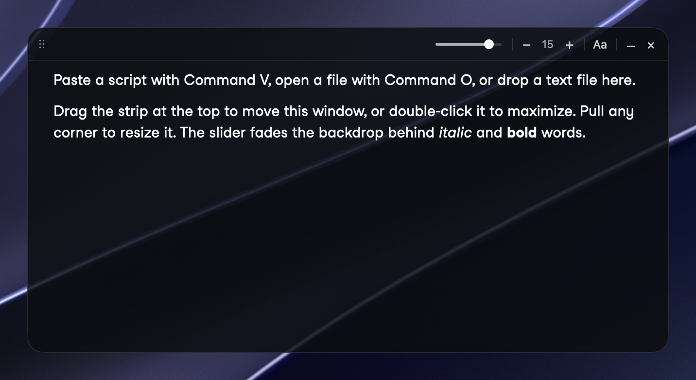

# Prompter

A floating, translucent script overlay for macOS that stays on top of full-screen apps without taking focus. Built in Rust with [GPUI](https://github.com/zed-industries/zed).



## Features

- **Always on top, never steals focus:** Runs as a non-activating `NSPanel` at pop-up level across all spaces and full-screen windows, with no Dock icon or menu bar.
- **Independent backdrop opacity:** Fade the panel from 15% to 100% while the script stays at full contrast.
- **Typography controls:** Step size from 10 to 120 pt in 1 pt increments, search installed font families (`Aa`), switch across 5 weights, and render `*italic*` and `**bold**` Markdown emphasis with gamma-corrected CoreText glyphs.
- **Persistent state:** Remembers window frame, opacity, font family, weight, size, and last opened file in `~/Library/Application Support/Prompter/settings.json`.

## Controls

| Action | How |
| --- | --- |
| Move | Drag the grip dots or empty top strip |
| Resize | Drag any edge or corner |
| Minimize | `_` in the strip or `Command M` |
| Font size | `−` / `+`, `Command +` / `Command -`, or `Command 0` to reset |
| Opacity | Drag the strip slider |
| Typeface & weight | `Aa` to search fonts (`↑` / `↓` / `Return`) and pick a weight chip |
| Load script | `Command V` to paste, `Command O` to open, drop a file, or pass a path on CLI |
| Scroll | Trackpad / wheel, `↑` / `↓`, `PageUp` / `PageDown`, or `Home` |
| Quit | `×` in the strip or `Command Q` |

## Building on macOS

Requires a Rust toolchain and Xcode Command Line Tools:

```sh
cargo build --release
./scripts/bundle.sh target/release/prompter
open dist/Prompter.app
```

### Cross-building for Apple Silicon from Linux

Needs `clang`, `lld`, the `aarch64-apple-darwin` target, and an unpacked macOS SDK (`MacOSX14.5.sdk`):

```sh
rustup target add aarch64-apple-darwin
MAC_SDK=/path/to/MacOSX14.5.sdk ./scripts/build-mac.sh
```

If GPUI's `gpui_apple` build fails on a missing `stitched_shaders.metal` (because upstream skips its build script on non-macOS hosts), run `MAC_SDK=/path/to/MacOSX14.5.sdk ./scripts/stitch-shaders.sh` once to generate it and finish the build.
